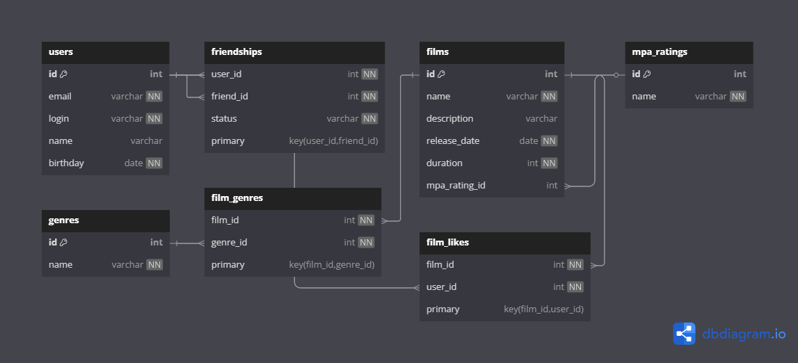

# Filmorate

Сервис для учёта фильмов и пользовательских оценок/лайков: хранит фильмы, пользователей, жанры и рейтинг MPA, позволяет ставить лайки и формировать подборки популярных фильмов.

📌 Учебный проект Яндекс Практикума (Java-разработчик, 2025).

---

## 🚀 Функционал
- CRUD для фильмов и пользователей  
- Лайки к фильмам, список популярных фильмов  
- Друзья/подписки между пользователями (двусторонняя дружба)  
- Жанры и рейтинг MPA у фильмов  
- (Опционально) Режиссёры, отзывы и рекомендации

---

## 🛠️ Стек технологий
- Java 17  
- Spring Boot (Web, Data JPA/Validation, Lombok)  
- PostgreSQL / H2 (тесты)  
- Maven  
- JUnit 5, Mockito  
- Docker (опционально)

---

## ▶️ Запуск

### Вариант 1. Локально
```bash
mvn clean install
mvn spring-boot:run
```
### Вариант 2. Docker (если есть docker-compose)
```bash
docker compose up --build
```

---

## 🧪 Тесты
```bash
mvn test
```
Интеграционные тесты используют H2, покрывают сервисы и репозитории.

---

## 📚 Основные эндпоинты (пример)
### Films

POST /films — создать фильм

PUT /films — обновить фильм

GET /films/{id} — получить фильм

GET /films — список фильмов

PUT /films/{id}/like/{userId} — поставить лайк

DELETE /films/{id}/like/{userId} — убрать лайк

GET /films/popular?count=10 — популярные фильмы

### Users

POST /users — создать пользователя

PUT /users — обновить пользователя

GET /users/{id} — получить пользователя

GET /users — список пользователей

PUT /users/{id}/friends/{friendId} — добавить в друзья

DELETE /users/{id}/friends/{friendId} — удалить из друзей

GET /users/{id}/friends — друзья пользователя

GET /users/{id}/friends/common/{otherId} — общие друзья

---

## 📈 ER-диаграмма

 

---

## 📄 Примеры SQL-запросов

### 🎬 Получение топ-N популярных фильмов (по количеству лайков):

```sql
SELECT f.id, f.name, COUNT(fl.user_id) AS likes
FROM films f
LEFT JOIN film_likes fl ON f.id = fl.film_id
GROUP BY f.id
ORDER BY likes DESC
LIMIT 10;
```

### 🤝 Получение друзей пользователя
```sql
SELECT u.*
FROM users u
JOIN friendships f ON u.id = f.friend_id
WHERE f.user_id = 1 AND f.status = 'CONFIRMED';
```
### 👥 Получение общих друзей двух пользователей
```sql
SELECT u.*
FROM users u
JOIN friendships f1 ON u.id = f1.friend_id AND f1.user_id = 1 AND f1.status = 'CONFIRMED'
JOIN friendships f2 ON u.id = f2.friend_id AND f2.user_id = 2 AND f2.status = 'CONFIRMED';
```
### 🏷 Получение всех жанров фильма
```sql
SELECT g.*
FROM genres g
JOIN film_genres fg ON g.id = fg.genre_id
WHERE fg.film_id = 1;
```
### 🎓 Получение всех фильмов с жанрами и рейтингом
```sql
SELECT f.id, f.name, f.description, r.name AS mpa_rating, g.name AS genre
FROM films f
LEFT JOIN mpa_ratings r ON f.mpa_rating_id = r.id
LEFT JOIN film_genres fg ON f.id = fg.film_id
LEFT JOIN genres g ON fg.genre_id = g.id;
```
### 💌 Получение входящих заявок в друзья (ожидающих подтверждения)
```sql
SELECT u.*
FROM users u
JOIN friendships f ON f.user_id = u.id
WHERE f.friend_id = 1 AND f.status = 'PENDING';
```
